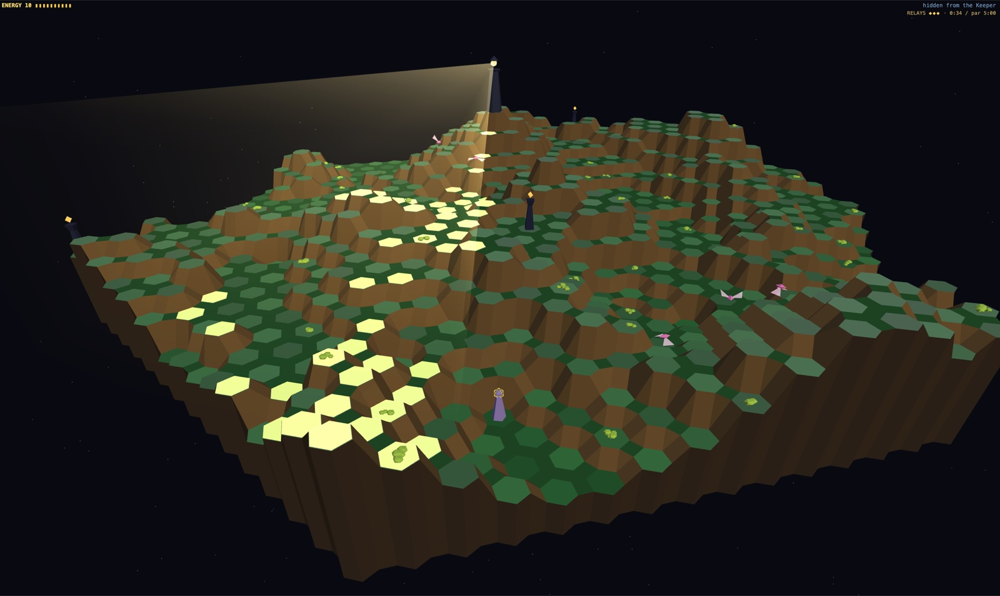

# Vantage

A first-person strategy game about energy, height and line of sight, built for the
browser. It runs fully locally, with no server.

Inspired by Geoff Crammond's [*The Sentinel*](https://en.wikipedia.org/wiki/The_Sentinel_(video_game)) (1986).

**Play it: https://brew-your-own.github.io/vantage-the-game/**



## How to play

New? Open the menu (M) and play the **tutorial**: fourteen short steps, on a gentler level.

You are a Wisp on a hex landscape watched by the Keeper, whose lamp sweeps a beam across
the land. Standing in the beam drains your energy. Harvest energy from the land, build
Shards to gain height, and transfer into Husks to move. Drain every Relay to put the
Keeper's lamp out, then transfer onto the Keeper's plinth to win.

| Key | Action |
| --- | --- |
| Mouse / arrows | look around (click locks the mouse, Esc releases it) |
| Click or H | harvest the targeted tile, or drain a Relay |
| 1 / 2 / 3 | place a Shard / Husk / Seed |
| F | feed a Spire |
| R | transfer into the targeted Husk |
| X | scatter (escape to a random tile) |
| V / K | your view / the Keeper's sight overlay |
| O | orbit view |
| P | pause |
| U / J | all sound / music on or off |
| N | random new level (always a fair one) |
| M | menu: levels, level code, settings, key remapping |

All game keys can be remapped in the menu. Progress and settings are saved in the browser.

The Keeper taunts you aloud, with subtitles. It speaks only with voices installed on your
computer (never the browser's online voices), so nothing leaves your machine; with no local
English voice you get subtitles only. Turn it off in the menu under controls & settings.

## Development

```sh
npm install
npm run dev      # dev server
npm test         # unit tests
npm run build    # static build in dist/ (GitHub Pages-ready)
npm run curate   # re-pick the campaign levels (writes src/core/campaignData.ts)
npm run balance  # Moth pressure on an idle Wisp, per campaign level
npm run pick-tutorial  # list level codes whose tutorial route works
```

In dev builds, the backquote key opens a panel for auditioning the adaptive music.

## Deployment

Every push to `main` runs `.github/workflows/deploy.yml`: tests, build, then publish `dist/`
to GitHub Pages (repo Settings → Pages → Source: GitHub Actions).

The title screen shows which build is live, from `git describe --tags`: a tag such as
`v1.0.0` when the deployed commit is tagged, `v1.0.0-3-gabc1234` for commits after a tag,
or just the short commit hash before the first tag. It links to the release or the commit.
To release, tag and push the tag (`git tag v1.0.0 && git push origin v1.0.0`): tag pushes
deploy too.

See [docs/PLAN.md](docs/PLAN.md) for the design and implementation plan.
